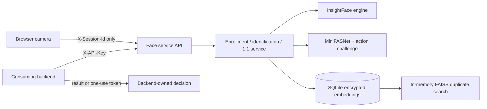

# FaceVerify

A standalone Python library and HTTP API for face enrollment, ID-free 1:N face identification, claimed-subject 1:1 verification, and liveness checks. It contains no voting, eligibility, ballot, officer, or election-result logic. A consuming system owns those decisions.

## Quick Start

Use CPython 3.11 or 3.12 on Windows. Configure a service API key, a JWT secret, and two local MiniFASNet ONNX files before starting. Anti-spoof models are never downloaded by this service. The browser app and API run together on one local port.

```powershell
py -3.12 -m venv .venv
.\.venv\Scripts\Activate.ps1
python -m pip install --upgrade pip
python -m pip install -r requirements.txt
if (-not (Test-Path .env)) { Copy-Item .env.example .env }
# Edit .env and replace the service-key and token-secret placeholders.
# Place the two licensed model files at the configured paths in models\.
python -m demo.demo_backend
```

FaceVerify is available at `http://127.0.0.1:5050`. The API is mounted into the same Waitress process, so session creation does not depend on a second server or a matching shell environment. InsightFace uses `CPUExecutionProvider`, `ctx_id=-1`, and a 640x640 detector input; its model is initialized lazily on the first camera analysis. Startup stops with the exact missing MiniFASNet file path if either required anti-spoof model is unavailable. InsightFace may download its own configured recognition package on first use if it is not already cached.

Browser camera access works on `http://127.0.0.1` and `http://localhost`. For any other host, serve the application over HTTPS and grant camera permission in the browser.

The service is designed to run as one process. In-memory rate limits do not coordinate across workers. Use HTTPS in deployment, preferably with a trusted reverse proxy.

## Architecture



Only opaque `subject_id` values matching `^[A-Za-z0-9_.:-]{1,128}$` are stored. SQLite keeps subject status, consent time, normalized float32 embeddings, session/challenge/token state, model metadata, and append-only audit events. It does not store face images, names, or raw embeddings in logs. `FACE_DB_KEY` encrypts embedding blobs with Fernet; keep the key outside the database and back it up separately.

## Integration Guide

1. The consuming backend calls `POST /api/v1/sessions` with its API key and purpose (`enroll`, `verify`, or `identify`). Enrollment and claimed-subject verification require `subject_id`; ID-free identification does not. It keeps the returned session ID private to that browser flow.
2. The browser receives only the session ID, opens the camera, calls preview/challenge endpoints, and submits frames with `X-Session-Id`. The service API key is never sent to the browser.
3. The backend reads a terminal result from `GET /api/v1/sessions/{id}/result`, or introspects the returned token with `POST /api/v1/tokens/introspect` and `consume: true`.
4. The consuming system records its own outcome in its own database. The browser's identify flow returns the matched enrolled ID; a face token is issued only for claimed-subject verification and is not a voting authorization.

```python
from client.python_client import ServiceClient

client = ServiceClient("https://face.example", api_key="from-a-secret-manager")
session = client.create_session("opaque-subject-42", "verify")
result = client.get_result(session["session_id"], wait=True)
```

## API

All endpoints are under `/api/v1` and accept JSON. The body limit is 16 MB. Backend endpoints require `X-API-Key`; browser endpoints require only `X-Session-Id`. Browser responses contain `decision`, `public_message`, and `retry_allowed`; a successful `identify` response also contains the matched `identified_subject_id`.

| Method and path | Caller | Purpose |
| --- | --- | --- |
| `POST /sessions` | Backend | Create an enrollment, claimed-ID verification, or ID-free identification session. |
| `GET /sessions/{id}/result` | Backend | Read terminal outcome and scores; 404 until terminal. |
| `GET /subjects`, `GET /subjects/{id}` | Backend | List/read opaque IDs and status, never embeddings. |
| `DELETE /subjects/{id}` | Backend | Delete subject and embeddings. |
| `POST /subjects/{id}/unlock` | Backend | Unlock with an audited reason. |
| `POST /tokens/introspect` | Backend | Validate a JWT and optionally consume it once. |
| `GET /health`, `GET /config` | Backend | Authenticated health and safe configuration. |
| `GET /session/challenge` | Browser | Get two distinct action prompts. |
| `POST /session/preview` | Browser | Throttled, low-resolution face-position guidance. |
| `POST /session/submit` | Browser | Submit enrollment/verification frames. |

Decisions include `enrolled`, `verified`, `identified`, `no_match`, `retry`, `rejected`, `duplicate_face`, `already_enrolled`, `locked`, and `expired`. ID-free identification searches active enrolled subjects and returns the matched ID only when the quality, liveness, vote, and similarity-threshold checks pass. See [openapi.yaml](openapi.yaml) for schemas.

## Models And Licenses

The default recognition model is InsightFace `buffalo_l`; `FACE_MODEL=antelopev2` is also accepted. A model mismatch with stored metadata is refused unless explicitly overridden. Changing models invalidates every stored embedding. InsightFace pretrained models are subject to InsightFace's non-commercial research terms; verify current model and dataset licenses before use.

MiniFASNet ONNX models are not bundled. Obtain compatible 80x80 weights from the [Silent-Face-Anti-Spoofing project](https://github.com/minivision-ai/Silent-Face-Anti-Spoofing), review source and weight licenses separately, and export locally:

```powershell
python -m pip install torch onnx
python tools/export_minifasnet_onnx.py --repo C:\src\Silent-Face-Anti-Spoofing --weights C:\models\2.7_80x80_MiniFASNetV2.pth --output models\minifasnet_a.onnx
python tools/export_minifasnet_onnx.py --repo C:\src\Silent-Face-Anti-Spoofing --weights C:\models\4_0_0_80x80_MiniFASNetV1SE.pth --output models\minifasnet_b.onnx
```

Set both `ANTISPOOF_MODEL_A_PATH` and `ANTISPOOF_MODEL_B_PATH`. Preprocessing follows the upstream predictor: centered square face crops expanded by scales 2.7 and 4.0, resized to 80x80, retained in OpenCV BGR order, divided by 255, and transposed to float32 `1x3x80x80`. Upstream `test.py` labels output class index 1 as real. The exact 106-point EAR contour indices are a model-layout assumption; render and verify them for the exact landmark model before enabling blink challenges in production.

InsightFace and MiniFASNet use `CPUExecutionProvider` for predictable performance on CPU-only Windows machines. Python 3.11 or 3.12 is recommended for compatibility with native ONNX Runtime and FAISS wheels.

## Calibration And Attack Set

After collecting representative subjects and multiple samples per subject, run:

```powershell
python tools/calibrate_from_db.py --target-far 0.001
```

The tool reports genuine/impostor distributions, pair counts, and FAR/FRR from 0.20 through 0.80. It chooses the lowest tested threshold meeting target FAR and writes `face_data/threshold.json`. At least `3 / target FAR` impostor pairs are recommended; small samples trigger a warning.

Build a local `attacks/<type>/*.jpg` set containing `real`, `print`, `screen`, `video`, and `mask` groups. Include printed photos, phone/laptop screens, replayed clips, varied subjects, camera distances, and several lighting conditions. Collect at least 50 images per type using the intended camera and kiosk. Keep this data local; `attacks/` is git-ignored.

```powershell
python tools/antispoof_eval.py --target-apcer 0.01
```

The evaluator reports sample/detection counts, APCER by attack type, BPCER for real faces, and ACER for thresholds 0.05 through 0.95. Undetected real faces count as false rejects; undetected attacks count as rejected attacks and are also reported. It writes `database/antispoof_threshold.json` and a ROC-style PNG. Prefer the threshold with the lowest BPCER among thresholds whose APCER for every included attack type is within target. Small or biased data is not a security guarantee.

`tools/tune_threshold.py` remains available for the prior image-dataset workflow. `tools/import_legacy.py` is manual and test-data-only; it never runs automatically.

## Configuration

Thresholds are initial values, not validated production settings. Tune them with representative deployment data. Explicit env values override `FACE_PROFILE=max_accuracy` defaults. Legacy variable aliases remain supported.

| Variable | Default | Meaning |
| --- | --- | --- |
| `FACE_PROFILE` | `default` | `default` or `max_accuracy`. |
| `FACE_MODEL` | `buffalo_l` | Recognition model; changing it invalidates stored embeddings. |
| `FACE_DET_SIZE` | `640` | Square detector input. |
| `FACE_DATA_DIR` | `face_data` | SQLite store/calibration directory. |
| `FACE_DB_KEY` | unset | Fernet key for embedding encryption. |
| `ALLOW_MODEL_MISMATCH` | `false` | Allow a mismatched model with a warning. |
| `MAX_IMAGE_PIXELS` / `MAX_IMAGE_SIDE` | `25000000` / `1600` | Image pixel cap and longest decoded side. |
| `MAX_CONTENT_LENGTH` | `16777216` | HTTP body byte limit. |
| `USE_TTA` / `POSE_GATE` / `EYES_OPEN_GATE` | `false` / `false` / `false` | Optional embedding augmentation and quality gates. |
| `EYES_OPEN_MIN_EAR` | `0.16` | Initial EAR lower bound for open eyes. |
| `ENROLL_MAX_FRAMES` / `ENROLL_MIN_FRAMES` / `ENROLL_KEEP` | `12` / `5` / `6` | Enrollment input and retention counts. Legacy alias: `MAX_REGISTER_IMAGES`. |
| `VERIFY_MAX_FRAMES` / `VERIFY_KEEP` | `8` / `3` | Verification input and retention counts. `MAX_FRAMES_VERIFY` and legacy `MAX_VERIFY_IMAGES` alias the max. |
| `VOTE_MIN_FRAMES` / `VOTE_MIN_AGREE` | `3` / `2` | Minimum verification frames and required matching votes. |
| `ENROLL_MIN_FACE_PX` / `VERIFY_MIN_FACE_PX` | `150` / `100` | Minimum face dimensions. Legacy alias: `FACE_MIN_SIZE`. |
| `FACE_MIN_DETECTION_SCORE` / `SECOND_FACE_MAX_RATIO` | `0.7` / `0.3` | Detection confidence and significant second-face ratio. |
| `BLUR_THRESHOLD` | `100` | Initial crop-based Laplacian variance. |
| `BRIGHTNESS_MIN` / `BRIGHTNESS_MAX` / `CONTRAST_MIN` | `60` / `200` / `25` | Initial face-crop lighting limits. |
| `POSE_YAW_MAX` / `POSE_PITCH_MAX` / `POSE_ROLL_MAX` | `30` / `25` / `30` | Initial absolute pose limits in degrees. |
| `SAME_PERSON_MIN` / `OUTLIER_MIN_SIM` | `0.5` / `0.4` | Initial frame identity and enrollment outlier thresholds. Legacy alias: `LIVENESS_IDENTITY_MIN`. |
| `VERIFY_THRESHOLD` / `FUSION_ALPHA` | `0.5` / `0.5` | Initial match threshold and sample/centroid fusion. Legacy threshold alias: `MATCH_THRESHOLD`. Calibrated JSON applies only when neither threshold env is set. |
| `DUPLICATE_THRESHOLD` / `IMPERSONATION_MARGIN` | `0.6` / `0.05` | Initial duplicate and competing-subject margins. |
| `MAX_ATTEMPTS` | `3` | Failed-attempt lockout count. |
| `ANTISPOOF_MODEL_A_PATH` / `ANTISPOOF_MODEL_B_PATH` | unset | Local MiniFASNet ONNX files. |
| `ANTISPOOF_THRESHOLD` / `ANTISPOOF_MIN_FRAME` | `0.7` / `0.5` | Initial mean and per-frame real-probability limits. |
| `REQUIRE_ANTISPOOF` | `true` | Fail closed if models are missing. |
| `REQUIRE_CHALLENGE` / `REQUIRE_ENROLL_CHALLENGE` | `true` / `false` | Require action challenge for verification/enrollment. |
| `CHALLENGE_TTL_SEC` / `CHALLENGE_MIN_SEC` | `20` / `1.5` | Challenge expiry and initial human-time floor. |
| `FRAMES_PER_ACTION` | `3` | Frames for each challenge action. |
| `BLINK_EAR_DROP` / `BLINK_RECOVER_RATIO` / `CHALLENGE_YAW_DELTA` | `0.6` / `0.85` / `0.15` | Initial blink and turn thresholds. |
| `PLANAR_CHECK` / `PLANAR_RESIDUAL_MIN` | `false` / `0.02` | Experimental planar check and initial normalized residual. |
| `SESSION_TTL_SEC` / `SESSION_MAX_SUBMITS` | `300` / `3` | Session lifetime and submit limit. |
| `TOKEN_TTL_SEC` | `120` | One-use JWT lifetime. |
| `FACE_SERVICE_API_KEY` / `FACE_TOKEN_SECRET` | unset | Required service key and JWT HMAC secret; token secret should be at least 32 random bytes. |
| `AUTH_DISABLED_FOR_DEV` | `false` | Disable service-key auth only for local development; logs a critical warning. |
| `KIOSK_MODE` / `KIOSK_ALLOWED_IPS` | `false` / empty | Optional kiosk IP restriction and comma-separated allowlist. |
| `HTTPS_TERMINATED` | `false` | Set true only behind trusted HTTPS termination. |
| `FACE_CORS_ORIGINS` | empty | Comma-separated browser origins. |
| `HOST` / `PORT` / `WAITRESS_THREADS` | `127.0.0.1` / `5000` / `4` | Single-process Waitress bind settings. |
| `FLASK_DEBUG` | `false` | Local Flask debug flag; production uses Waitress. |
| `PREVIEW_INTERVAL_SEC` | `0.275` | Preview request interval. |
| `RATE_LIMIT_IP_PER_MINUTE` / `RATE_LIMIT_SUBJECT_PER_MINUTE` | `120` / `30` | In-memory request limits. |
| `ATTEMPT_BACKOFF_BASE_SEC` | `0.1` | Exponential rate-limit backoff base. |
| `DB_BUSY_RETRIES` / `DB_RETRY_DELAY_SEC` | `3` / `0.05` | SQLite write retry settings. |
| `DETECT_MIN_SCORE` | `0.5` | Preview face detector confidence. |
| `DETECT_MIN_WIDTH_RATIO` / `DETECT_MIN_HEIGHT_RATIO` / `DETECT_MIN_AREA_RATIO` | `0.12` / `0.12` / `0.03` | Preview face geometry. |
| `DETECT_CENTER_X_MIN` / `DETECT_CENTER_X_MAX` | `0.2` / `0.8` | Horizontal preview center range. |
| `DETECT_CENTER_Y_MIN` / `DETECT_CENTER_Y_MAX` | `0.15` / `0.85` | Vertical preview center range. |
| `LIVENESS_LANDMARK_MOVEMENT` / `LIVENESS_PIXEL_DIFFERENCE` | `2.0` / `2.0` | Fallback movement thresholds when challenge is disabled. |

`FACE_PROFILE=max_accuracy` defaults: `ENROLL_MIN_FRAMES=5`, `ENROLL_KEEP=6`, `USE_TTA=true`, `FUSION_ALPHA=0.5`, `VERIFY_MAX_FRAMES=5`, `VERIFY_KEEP=3`, `VOTE_MIN_FRAMES=3`, `VOTE_MIN_AGREE=3`, `VERIFY_MIN_FACE_PX=150`, `POSE_GATE=true`, `EYES_OPEN_GATE=true`, and `IMPERSONATION_MARGIN=0.08`. Mandatory challenge capture needs a baseline plus three frames for each of two actions (seven total), so the profile's 5-frame cap conflicts with the default challenge. Set `VERIFY_MAX_FRAMES=7` or reduce `FRAMES_PER_ACTION` before using this profile with mandatory challenges.

## Threat Model And Limits

| Threat | Mitigations | Remaining limit |
| --- | --- | --- |
| Printed photo or screen replay | MiniFASNet ensemble, blink/turn challenge, optional planar check. | Model errors and unrepresented attacks remain possible. Validate locally. |
| Different person substituted mid-capture | Pairwise embedding identity binding over quality/live/challenge frames. | Thresholds require deployment data and can reject genuine captures. |
| Wrong claimed subject | Strict 1:1 comparison and competing-subject impersonation margin. | Not an identity-proofing or government-ID check. |
| Incorrect ID-free match | Quality/liveness gates, multi-frame votes, similarity threshold, and runner-up margin. | Tune thresholds with representative local test data; identification returns an enrolled ID to the browser. |
| Replayed service token | Signed JWT, persisted `jti`, atomic one-time consumption. | Protect backend secrets and transport; token is not an authorization decision. |
| API abuse | API key, session IDs, rate limits, lockout, security headers, optional kiosk allowlist. | In-memory controls require one process; use shared storage before scaling. |
| Virtual camera or altered client | Camera-label, resolution, and frame-rate checks. | Browser checks are bypassable and cannot stop injected video. |

**Browser-based liveness cannot stop injected video. Real use requires a supervised, locked-down kiosk**, HTTPS, physical camera controls, restricted OS accounts, and trained operators. Browser camera labels and track settings are signals only, not a security boundary.

## Privacy And Operations

- No face image is written to disk, SQLite, logs, audit data, or temp files. Frames exist only in request/process memory.
- Use random opaque subject IDs; do not put names or voter identifiers in IDs, metadata, or audit reasons.
- `FACE_DB_KEY` encrypts embedding blobs at rest; it does not encrypt backups unless the backup layer does so.
- `DELETE /subjects/{id}` removes vectors and subject state; append-only audit entries remain.
- `database/`, `face_data/`, model weights, attack sets, and datasets are git-ignored.
- The browser interface and face API share one application process. Use HTTPS and a protected reverse proxy for remote access.

## Browser App And Container

Run the application in one PowerShell terminal:

```powershell
python -m demo.demo_backend
```

Open http://127.0.0.1:5050. The browser receives a session ID only; the server retains the service key and handles result/token introspection. The service API can still be run independently with `python serve.py` when integrating another consuming backend.

```sh
docker build -t face-verification .
docker run --rm -p 5000:5000 \
	-e FACE_SERVICE_API_KEY -e FACE_TOKEN_SECRET -e FACE_DB_KEY \
	-e ANTISPOOF_MODEL_A_PATH=/models/a.onnx -e ANTISPOOF_MODEL_B_PATH=/models/b.onnx \
	-v face-data:/var/lib/face-data -v ./models:/models:ro face-verification
```

The image runs non-root with one Waitress process. Do not scale horizontally without replacing in-memory rate limits with a shared limiter.

## Testing

```powershell
pip install -r requirements-dev.txt
python -m pytest -q
```
